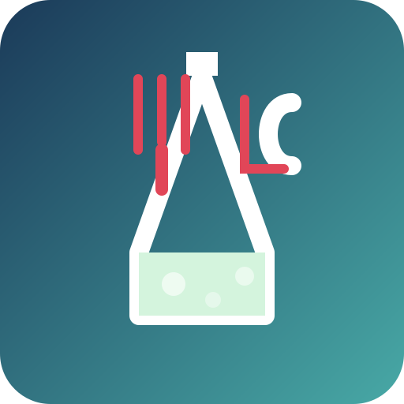

# CulinaryLab WordPress Theme



A scientific laboratory approach to culinary arts inspired by molecular gastronomy. This WordPress theme and plugin package provides a unique, laboratory-style presentation for recipes with features specifically designed for precision cooking techniques.

## 🧪 Features

- **Scientific Lab Aesthetic**: Clean, precise design with lab-inspired elements
- **Recipe Components System**: Support for multi-part recipes (like cakes with separate base, filling, and topping)
- **Interactive Shopping List**: Checkable ingredient lists for easier shopping
- **Adjustable Servings**: Dynamic recalculation of ingredient quantities
- **Embedded Video Links**: Support for adding links to demonstration videos within recipe steps
- **Taxonomies**: Recipe categorization by type and tags
- **Scientific Protocol Presentation**: Visually structured as experimental protocols
- **Mobile-Responsive Design**: Works on all device sizes
- **Multilingual Support**: Built-in Dutch (nl_NL) and English language support

## 🔬 Getting Started

### Prerequisites

- WordPress 5.8+
- PHP 7.4+
- MySQL 5.7+

### Installation

#### Local Development with Docker

1. Clone the repository:
   ```bash
   git clone https://github.com/kretar/culinarylab.git
   cd culinarylab
   ```

2. Start the Docker environment:
   ```bash
   docker-compose up -d
   ```

3. Wait for the `setup` container to finish (`docker-compose logs -f setup`). It installs WordPress in Dutch, activates the theme and plugin, and adds sample recipes, categories and a blog post.

4. Open http://localhost:8080 (admin at http://localhost:8080/wp-admin, login `admin` / `admin`, for local development only). To start over with a clean site, run `docker-compose down -v`.

#### Production Installation

1. Open the [latest release](https://github.com/kretar/culinarylab/releases/latest) and download the two attached files, `culinarylab-x.x.x.zip` and `recipe-plugin-x.x.x.zip` (not "Source code").
2. In your WordPress admin:
   - Appearance → Themes → Add New → Upload Theme → upload `culinarylab-x.x.x.zip` → Activate
   - Plugins → Add New → Upload Plugin → upload `recipe-plugin-x.x.x.zip` → Activate

Both zips contain a single fixed folder (`culinarylab/` and `recipe-plugin/`), so WordPress installs them under those names whatever the file is called.

#### Installing Upgrades

1. Make a backup of your site (files and database).
2. Upload the new zips exactly as for a first installation. When WordPress reports that the theme or plugin is already installed, choose **Replace current with uploaded**.
3. The plugin repairs the recipe URLs itself after an upgrade. If recipe pages still show a 404, go to Settings → Permalinks and save once.
4. Open a recipe and the home page to check.

Recipes are stored in the database, not in the plugin folder, so replacing the plugin does not touch them.

**One-time migration from releases before 1.2.1:** older zips had no folder inside, so WordPress installed them in folders with a random suffix (for example `culinarylab-Xh8p69PnPlsyLB6m` and `recipe-plugin-1.2.0-3-Llzf5nTCloQ0cuGp`). Upload the new zips, then: deactivate the old plugin and activate the new `recipe-plugin`; activate the new `culinarylab` theme and check Appearance → Menus and Widgets (theme settings are stored per theme folder); finally delete the old folders. Do not keep two copies of the plugin active at the same time.

## 🧪 Using the Theme

### Creating Recipes

1. Create a new recipe post through the "Recipes" menu item
2. Add mandatory fields:
   - Title - The recipe name
   - Featured Image - Main recipe photo
   - Description - Introduction to the recipe
   - Preparation Time, Cooking Time, Servings, and Difficulty

3. Add ingredients in the format:
   ```
   Amount - Unit - Ingredient
   ```
   Example:
   ```
   200 - grams - All-Purpose Flour
   2 - tablespoons - Olive Oil
   ```

4. Add instructions (one step per line)
   - You can include HTML links to videos: `Mix thoroughly. <a href="https://example.com/video" target="_blank">Watch demonstration</a>`

5. For multi-component recipes, use the "Recipe Sections" meta box to create separate parts with their own ingredients and instructions

### Customization

The theme is designed to be used with minimal customization, but you can:

1. Add your logo via Appearance → Customize → Site Identity
2. Customize menus via Appearance → Menus
3. Add widgets to the sidebar and footer areas
4. Adjust colors by modifying the CSS variables in `style.css`

## 🧬 Development

### Theme Structure

```
masterchef/
├── assets/
│   ├── css/           # Stylesheets
│   ├── images/        # Theme images and icons
│   └── js/            # JavaScript files
├── inc/
│   ├── recipe-functions.php    # Recipe-specific functions
│   └── template-tags.php       # Helper template functions
├── template-parts/            # Reusable template parts
│   └── recipe/               # Recipe-specific templates
├── functions.php              # Main theme functions
├── style.css                  # Main stylesheet with theme info
└── various template files     # WordPress template files
```

### Plugin Structure

```
recipe-plugin/
├── assets/
│   ├── css/           # Plugin CSS
│   └── js/            # Plugin JavaScript
├── includes/
│   ├── meta-boxes.php  # Custom meta boxes for recipes
│   ├── post-types.php  # Recipe custom post type
│   └── taxonomies.php  # Recipe categories and tags
├── languages/         # Translation files
└── recipe-plugin.php  # Main plugin file
```

### Development Workflow

1. Make changes to the theme or plugin files
2. Test locally using the Docker environment
3. Commit changes following the conventional commits format
4. Create a new tag for releases (will trigger automatic packaging)

## 📦 Release Process

Releases are built by one GitHub Actions workflow (`.github/workflows/release.yml`) that attaches the theme and plugin zips to a single release.

1. Set the new version everywhere it is stored:
   ```bash
   scripts/bump-version.sh x.x.x
   ```
   This updates `masterchef/style.css`, `masterchef/functions.php` and `recipe-plugin/recipe-plugin.php`.

2. Add a `## x.x.x - YYYY-MM-DD` section to `CHANGELOG.md`. It becomes the release notes.

3. Optionally build the zips locally to see what will be released (output in `dist/`):
   ```bash
   sh scripts/package.sh
   ```
   The script refuses to build when the version numbers disagree or the changelog entry is missing.

4. Merge the change, then tag `main`:
   ```bash
   git checkout main && git pull
   git tag -a vx.x.x -m "Release version x.x.x"
   git push origin vx.x.x
   ```

5. The workflow checks that the tag matches the version in the code, builds and verifies both zips and publishes one release. To try the build without releasing, run Actions → Release → Run workflow.

## 🧑‍🔬 Contributing

Contributions are welcome! Please feel free to submit a Pull Request.

1. Fork the Project
2. Create your Feature Branch (`git checkout -b feature/amazing-feature`)
3. Commit your Changes (`git commit -m 'Add some amazing feature'`)
4. Push to the Branch (`git push origin feature/amazing-feature`)
5. Open a Pull Request

## 📄 License

This project is licensed under the GPL v2 or later - see the LICENSE file for details.

## 🙏 Acknowledgments

- Inspired by molecular gastronomy and scientific cooking techniques
- Developed for food science enthusiasts and precision home cooks
- Special thanks to all contributors who have helped shape this project